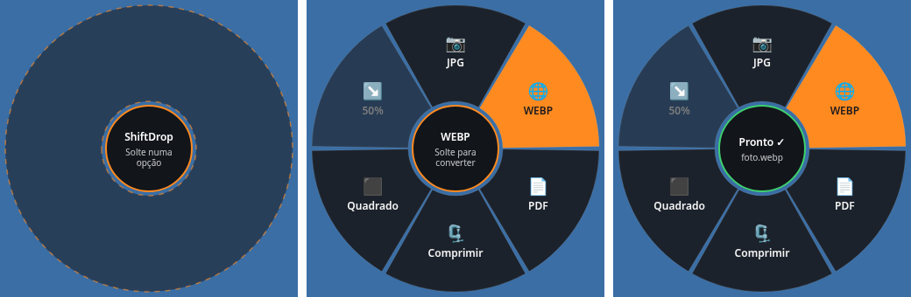
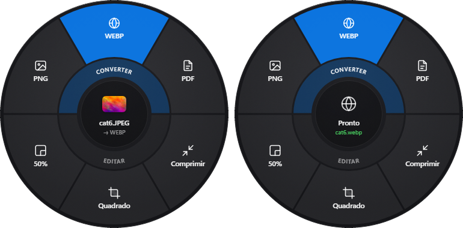

# ShiftDrop

Versão Windows do Tangerine (app de Mac): **segure Shift enquanto arrasta um arquivo** no Explorer e um menu radial aparece em volta do cursor. Solte o arquivo na opção desejada e a conversão é feita **localmente**, com a saída na mesma pasta (nunca sobrescreve: gera `nome (1).ext`).

Feito com Tauri v2 (Rust + HTML/JS simples). Roda na bandeja do sistema.





Visual no estilo Tangerine/macOS: disco de vidro com desfoque real (acrylic do Windows) recortado em círculo, sombra suave, setores sólidos com ícone + rótulo, destaque azul suave sob o cursor, miniatura do arquivo no centro e entrada em 150 ms (escala + fade). Com muitas ações, o anel interno mostra as categorias (Converter / Editar) e o externo, as ações.

## O que ele faz

| Tipo | Ações | Precisa de |
|---|---|---|
| Imagem (png, jpg, webp, bmp, gif, tiff, ico) | PNG, JPG, WEBP, PDF (vários = **Juntar PDF**), Comprimir, Quadrado, 50% | nada (nativo em Rust) |
| Imagem (heic, avif, svg, psd, tga, raw…) | as mesmas | ImageMagick |
| Vídeo (mp4, mov, mkv, avi, webm…) | MP4, WEBM, GIF, MP3 (extrai áudio), Comprimir, **Juntar** | ffmpeg |
| Áudio (mp3, wav, ogg, flac, m4a…) | MP3, WAV, OGG, Comprimir, **Juntar** | ffmpeg |
| Documento (docx, doc, odt, pptx, xlsx, rtf, txt) | PDF | LibreOffice |

Opções cuja ferramenta não está instalada aparecem desabilitadas (cinza) com o motivo. O menu da bandeja mostra o que foi detectado.

Ferramentas externas são procuradas no `PATH`, nas pastas padrão (WinGet, `Program Files`) ou em variáveis `SHIFTDROP_FFMPEG`, `SHIFTDROP_MAGICK`, `SHIFTDROP_SOFFICE`.

```powershell
winget install Gyan.FFmpeg
winget install ImageMagick.ImageMagick
winget install TheDocumentFoundation.LibreOffice   # opcional, para DOCX → PDF
```

## Como usar

1. Abra o ShiftDrop (fica na bandeja).
2. No Explorer ou na área de trabalho, comece a arrastar um ou mais arquivos e **segure Shift**.
3. O menu aparece no cursor. Leve até a opção e solte. Soltar no centro cancela.

Sem Shift? Use **“Abrir menu aqui”** no menu da bandeja e arraste o arquivo para o círculo.

Por padrão o gesto só vale para arrastes que começam no Explorer (e alguns gerenciadores de arquivo). Para qualquer app, defina `SHIFTDROP_ANY_APP=1`.

### Linha de comando

O mesmo executável também converte pelo terminal:

```powershell
shiftdrop.exe tools                         # ferramentas detectadas
shiftdrop.exe actions foto.png              # ações possíveis (JSON)
shiftdrop.exe convert to_webp foto.png      # converte, imprime o caminho de saída
shiftdrop.exe convert merge_video a.mp4 b.mov
shiftdrop.exe preview foto.jpg --hover 1  # abre o menu no centro da tela (demonstração/capturas)
```

## Desenvolvimento

Requisitos: Rust (toolchain MSVC + Build Tools do Visual Studio), Node 18+, WebView2.

```powershell
npm install
npm run dev        # roda o app
npm test           # testes de conversão de ponta a ponta (geram arquivos reais)
npm run build      # gera o instalador NSIS em src-tauri/target/release/bundle/nsis
```n
Autoteste do arrastar (OLE de verdade, sem mouse): abre o overlay, cria o IDataObject do Shell (CF_HDROP) para o arquivo e chama DragEnter/DragOver/Drop no drop target do overlay. Log em `%TEMP%\shiftdrop-drag.log`.

```powershell
shiftdrop.exe selftest-drag C:\caminho\cat6.JPEG --drop   # solta no setor do topo (WEBP para imagens)
```

## Como funciona o gesto

Uma thread consulta o estado global do botão esquerdo e do Shift (`GetAsyncKeyState`) a cada 15 ms. Se o clique começou numa janela do Explorer e o cursor andou com Shift pressionado, a janela transparente do menu é exibida centrada no cursor. Ela é um alvo de drop normal do Windows, então o arraste em andamento cai direto nela. Sem hook de baixo nível e sem injetar DLL.
