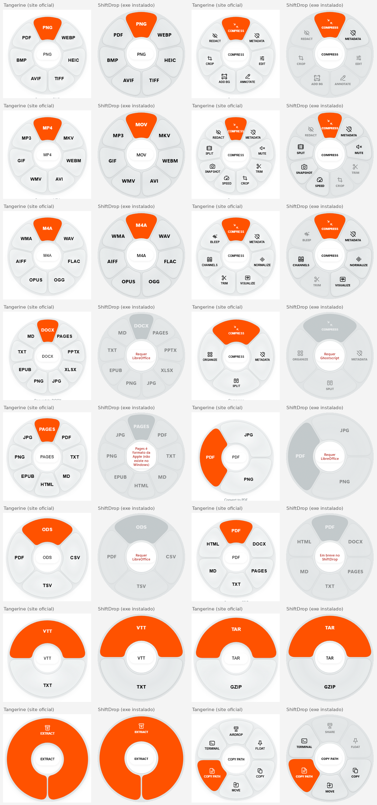

# ShiftDrop

Versão Windows do [Tangerine](https://tangerineformac.com/) (app de Mac). **Comece a arrastar um arquivo no Explorer e toque uma tecla**: aparece uma roda em volta do cursor. Solte o arquivo na opção desejada. Tudo roda **localmente** e a saída vai para a mesma pasta, sem sobrescrever (`nome (1).ext`).

Feito com Tauri v2 (Rust + HTML/JS simples). Fica na bandeja do sistema.



## As três rodas

| Tecla (durante o arraste) | Roda | Para quê |
|---|---|---|
| **Shift** | Convert formats | converter para outro formato |
| **Ctrl** | File tools | comprimir, metadados, cortar, juntar… |
| **Alt** | File actions | copiar, mover, copiar caminho, terminal (vale para pastas também) |

A roda fica aberta até você soltar. Dá para trocar de roda no meio do arraste tocando outra tecla. Soltar no centro cancela. Tamanho, teclas e "iniciar com o sistema" ficam em **Configurações** (ícone da bandeja) e são gravados em `config.json`. Variáveis de ambiente ainda ganham: `SHIFTDROP_SCALE` (padrão `0.75`; `1` = tamanho do Tangerine) e `SHIFTDROP_KEYS=convert,tools,actions` (ex. `ctrl,shift,alt`).

Forma e layout seguem o Tangerine; o acabamento é Windows 11: tema claro/escuro do sistema, paleta da logo (núcleo `#2E8CFF` → `#0749A8`, painel `#3EB6F5` → `#1B8EE3`, dobra `#8FD6FB`, anel `#FFFFFF` → `#B9C0C9`, fundo escuro `#262626`) no setor ativo, Segoe UI Variable, ícones Segoe Fluent Icons. Sem acrylic do DWM (ele ignora o recorte circular e pintava um quadrado atrás da roda); rótulos em CAPS, pílula branca no centro com a opção sob o cursor e entrada "bloom" de 200 ms. O número de setores varia por tipo: 2 viram semicírculos e 1 vira um anel inteiro. Sem botões magnéticos e sem cursor customizado.

Referências usadas: `docs/ref/` (prints do site, do app e frames do reel). Comparações lado a lado: `docs/compare-*.png`.

## O que cada roda oferece

| Tipo | Convert (Shift) | File tools (Ctrl) |
|---|---|---|
| Imagem | PNG JPG WEBP HEIC TIFF AVIF BMP PDF | COMPRESS METADATA ~~EDIT ANNOTATE ADD BG CROP REDACT~~ |
| Vídeo | MP4 MOV MKV WEBM AVI WMV GIF MP3 | COMPRESS METADATA MUTE SPEED (2×) SNAPSHOT SPLIT (metades) JOIN ~~TRIM CROP REDACT~~ |
| Áudio | MP3 M4A WAV FLAC OGG OPUS AIFF WMA | COMPRESS METADATA NORMALIZE VISUALIZE CHANNELS ~~TRIM BLEEP~~ |
| PDF | DOCX TXT (LibreOffice), JPG PNG (ImageMagick + Ghostscript), ~~PPTX XLSX EPUB MD~~ | ~~COMPRESS METADATA SPLIT ORGANIZE~~ |
| Documentos | PDF TXT HTML EPUB PNG JPG DOCX (LibreOffice), MD (pandoc) | — |
| Slides | PDF JPG PNG (LibreOffice) | — |
| Planilhas | XLSX ODS CSV TSV PDF (LibreOffice) | — |
| EPUB | DOCX TXT MD HTML (pandoc) | — |
| Legendas | SRT VTT TXT (nativo) | — |
| Compactados | ZIP TAR GZIP (tar.exe do Windows) | EXTRACT |
| **File actions (Alt)** | COPY, MOVE, COPY PATH, TERMINAL · ~~SHARE FLOAT~~ | |

Riscado = aparece desabilitado com o motivo (etapa 2). **PAGES** fica sempre desabilitado: é formato da Apple. Opções cuja ferramenta não está instalada aparecem desabilitadas, e a pílula do centro mostra o motivo (ex. "Requer LibreOffice").

Ferramentas externas são procuradas no `PATH`, nas pastas padrão ou em `SHIFTDROP_FFMPEG`, `SHIFTDROP_MAGICK`, `SHIFTDROP_SOFFICE`, `SHIFTDROP_PANDOC`:

```powershell
winget install Gyan.FFmpeg
winget install ImageMagick.ImageMagick
winget install TheDocumentFoundation.LibreOffice   # documentos, slides, planilhas
winget install JohnMacFarlane.Pandoc               # MD e EPUB
winget install ArtifexSoftware.GhostScript         # PDF → imagem
```

## Linha de comando

```powershell
shiftdrop.exe tools                          # ferramentas detectadas
shiftdrop.exe wheels foto.jpg                # as 3 rodas para o arquivo (JSON)
shiftdrop.exe convert conv:webp foto.jpg     # converte (ids conv:/tool:/act:)
shiftdrop.exe convert tool:videoSnapshots clipe.mp4
shiftdrop.exe preview foto.jpg --mode tools --hover 0   # mostra a roda (capturas/QA)
shiftdrop.exe selftest-drag foto.jpg --drop  # simula um drag OLE no próprio processo
```

## Atualizações

Na primeira abertura o app pergunta se deve avisar quando sair versão nova. A preferência fica em Configurações. A checagem lê `https://github.com/vitorkloy/shiftdrop/releases/latest/download/latest.json` alguns segundos depois de abrir e de novo a cada 6 horas. Se houver versão maior, o item **Atualizar para x.y.z…** aparece na bandeja; com o aviso ligado, também vai uma notificação. Só baixa e instala depois de **Atualizar agora** (Windows: instalador passivo; macOS: `.app`; Linux AppImage: troca o próprio arquivo). Quem instalou o `.deb` vê o aviso e abre a página do release.

Para o CI assinar o `latest.json`, o repositório precisa dos secrets `TAURI_SIGNING_PRIVATE_KEY` (conteúdo de `~/.tauri/shiftdrop.key`) e `TAURI_SIGNING_PRIVATE_KEY_PASSWORD` (vazio se a chave não tiver senha). Build local com instalador:

```powershell
$env:TAURI_SIGNING_PRIVATE_KEY = "$env:USERPROFILE\.tauri\shiftdrop.key"
npm run build
```

## Desenvolvimento

Requisitos: Rust (MSVC), Node 18+, WebView2.

```powershell
npm install
npm run dev        # roda o app
npm test           # testes de conversão de ponta a ponta
npm run build      # instalador NSIS em src-tauri/target/release/bundle/nsis
```

## Como funciona

No Windows, hooks de baixo nível (`WH_MOUSE_LL` e `WH_KEYBOARD_LL`) numa thread com loop de mensagens: ocioso, não há polling. Se o arraste começou no Explorer e uma das teclas foi pressionada, a roda aparece no cursor. Tocar outra tecla troca a roda (evento `wheel-mode`). O WebView da roda só existe enquanto ela é usada e some alguns segundos depois de esconder. No macOS e no Linux a leitura continua por `device_query` (15 ms com o botão pressionado, 120 ms ocioso).

O drop é recebido por uma janela nativa própria (`ShiftDropCatcher`, circular, por cima da roda) com um `IDropTarget` que lê o caminho (`CF_HDROP`) já no **DragEnter**, então os setores certos aparecem antes de soltar. Ao abrir, a roda sempre desenha setores genéricos e troca pelos do tipo assim que o arquivo é identificado.

Log em `%LOCALAPPDATA%\ShiftDrop\log.txt` (gesto, tecla, roda, DragEnter/Drop com caminhos, console do JS e resultado).

## Plataformas (v0.2.0)

Os builds saem do GitHub Actions (`.github/workflows/release.yml`, `tauri-apps/tauri-action`) em tag `v*` ou manualmente (workflow_dispatch), como **release publicado** (o updater precisa do `latest.json` público):

| Plataforma | Pacote | Gesto | Limitações |
|---|---|---|---|
| Windows 10/11 | NSIS `.exe` (WebView2 bootstrapper embutido) | Hooks WH_MOUSE_LL / WH_KEYBOARD_LL + drop target OLE nativo (CF_HDROP) + recorte `SetWindowRgn` | Vidro é CSS (sem Mica/acrylic do DWM), então o visual é igual no Win10 e no Win11. |
| macOS 11+ | `.dmg` universal (Apple Silicon + Intel) | Leitura global de mouse/modificadores via CoreGraphics (`device_query`); drop pelo drag-drop do Tauri numa janela transparente | Peça permissão em *Ajustes > Privacidade > Monitoramento de Entrada/Acessibilidade*. App não assinado/notarizado: abra com botão direito > Abrir. Ctrl ou ⌘ = File tools, Option = File actions. Sem cor de destaque do sistema (usa laranja). |
| Linux | `.deb` e `.AppImage` (webkit2gtk-4.1) | X11/XWayland via `device_query` (`DISPLAY`); drop pelo drag-drop GTK do Tauri | **Wayland puro**: sem leitura global de teclado/mouse, use o item da bandeja "Abrir menu aqui" e arraste o arquivo para a roda. Recorte circular depende do compositor (transparência). |

Comum: o gesto abre a roda a partir de qualquer app (só no Windows existe o filtro por gerenciador de arquivos). COPY/COPY PATH usam `pbcopy` (mac) ou `wl-copy`/`xclip` (Linux); MOVE usa `osascript` / `zenity`/`kdialog`; TERMINAL abre Terminal.app / `x-terminal-emulator`.

### Dependências no macOS/Linux

As conversões usam as ferramentas do sistema, procuradas no PATH e também em `/opt/homebrew/bin`, `/usr/local/bin`, `/usr/bin` (apps GUI não herdam o PATH do shell), ou forçadas por `SHIFTDROP_FFMPEG`, `SHIFTDROP_MAGICK`, etc.

- macOS: `brew install ffmpeg imagemagick pandoc ghostscript` e `brew install --cask libreoffice`.
- Debian/Ubuntu: `sudo apt install ffmpeg imagemagick pandoc ghostscript libreoffice` (o `.deb` já puxa ffmpeg e imagemagick).

O que faltar aparece desabilitado na roda com o motivo ("Requer …").

## Dependências embutidas (v0.3.0): o usuário não instala nada

| Plataforma | Embutido no instalador | Baixado no 1º uso (pasta de dados do app) |
|---|---|---|
| Windows | ffmpeg + ffprobe, ImageMagick portable, pandoc, Ghostscript (`<pasta do app>\tools`) | LibreOffice: MSI oficial extraído sem admin em `%LOCALAPPDATA%\ShiftDrop\tools\LibreOffice` |
| macOS | — | ffmpeg/ffprobe (evermeet.cx), pandoc (GitHub), em `~/Library/Application Support/ShiftDrop/tools` |
| Linux | — | ffmpeg/ffprobe estáticos (johnvansickle.com, x86_64), pandoc, em `~/.local/share/shiftdrop/tools` |

O que já existe no sistema tem preferência só quando não há cópia embutida. Durante o download a roda mostra `BAIXANDO LIBREOFFICE 42%`. Miniaturas e a listagem das rodas nunca disparam downloads, só soltar numa ação. `SHIFTDROP_TOOLS=<pasta>` aponta para outra pasta de ferramentas.

Ainda não baixados no macOS/Linux: ImageMagick, Ghostscript e LibreOffice (use `brew`/`apt`, veja acima). As conversões de imagem básicas (PNG/JPG/WEBP/BMP/TIFF/GIF) são nativas e não precisam deles.

No CI, `scripts/fetch-tools-windows.ps1` baixa as ferramentas antes do `tauri build`. Rode o mesmo script localmente para gerar o instalador completo.

### Licenças de terceiros

O ShiftDrop é MIT. As ferramentas são programas independentes, distribuídos junto (agregação) e chamados como processos externos, cada um com sua licença:

- **FFmpeg** (build "essentials" de gyan.dev): GPLv3. Código-fonte em https://ffmpeg.org e https://www.gyan.dev/ffmpeg/builds/.
- **ImageMagick**: ImageMagick License (Apache-2.0-like), https://imagemagick.org/script/license.php.
- **pandoc**: GPLv2+, https://github.com/jgm/pandoc.
- **Ghostscript**: AGPLv3, https://ghostscript.com (código em https://github.com/ArtifexSoftware/ghostpdl).
- **LibreOffice** (baixado, não redistribuído): MPL-2.0, https://www.libreoffice.org/about-us/licenses.

Os textos de licença ficam em `tools\LICENSE-*.txt` quando o pacote original os inclui.
